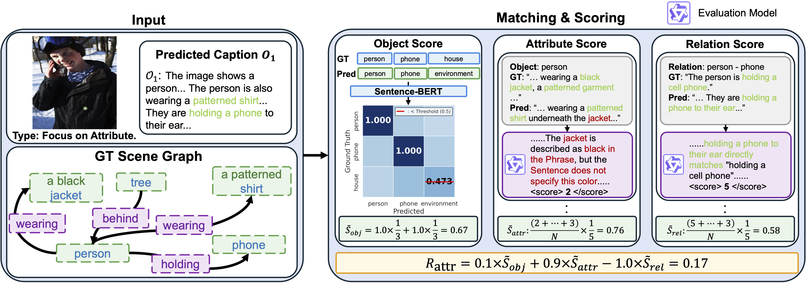

# FoCUS: Fine-grained Captioning Control Using Scene Rewards

[](https://focus-emnlp2026.github.io/)
[](https://aclanthology.org/2026.emnlp-main.2622/)

This repository contains the official implementation of **FoCUS**, introduced in our **EMNLP 2026 Main** paper [*Controllable Image Captioning with Prompt-Conditioned Scene Rewards*](https://aclanthology.org/2026.emnlp-main.2622/).

In the paper, we first trained each backbone on prompt-specific image–caption pairs with supervised fine-tuning (SFT), then initialized GRPO from the resulting checkpoint.



**Figure 2:** Overview of the FoCUS pipeline. During training, given an image and a natural-language control prompt, FoCUS aligns the generated caption with scene-graph annotations and computes component scores for objects, attributes, and relations. These scores are aggregated with prompt-conditioned signed weights to form the control objective, which emphasizes requested content and suppresses off-scope content.

## Contents

- [Install and download](#install-and-download)
- [Configure the images and rewards](#configure-the-images-and-rewards)
- [Start the judge](#start-the-judge)
- [Train](#train)
- [Acknowledgments](#acknowledgments)
- [License](#license)
- [Citation](#citation)

## Install and download

On the training machine, run from the repository root.

```bash
python3.10 -m venv .venv
source .venv/bin/activate
python -m pip install -r requirements.txt
python -m pip install flash-attn==2.7.4.post1 --no-build-isolation
python -m spacy download en_core_web_lg
hf download Qwen/Qwen2.5-VL-3B-Instruct --local-dir models/Qwen2.5-VL-3B-Instruct
hf download sentence-transformers/all-MiniLM-L6-v2 --local-dir models/all-MiniLM-L6-v2 --exclude 'onnx/*' 'openvino/*' '*.bin' '*.ot' '*.h5'
cp configs/train.example.yaml train.local.yaml
```

For SDPA, skip the `flash-attn` install and set `model.model_kwargs.attn_implementation: sdpa` in `train.local.yaml`.

## Configure the images and rewards

In `train.local.yaml`, set `data.annotations` to your scene annotation JSON file and `data.image_dir` to the directory containing your images. By default, the loader splits the annotations into training and validation sets.

```text
data/my_scenes/
├── annotations.json
└── images/
    ├── kitchen/
    │   └── cup.jpg
    └── bicycle.jpg
```

When launching from the repository root with this layout, update these two paths in the existing `data` section. Absolute paths also work.

```yaml
data:
  annotations: data/my_scenes/annotations.json
  image_dir: data/my_scenes/images
```

Write one JSON array in `annotations.json`, with one entry per image. Each `image` is a path **relative to `data.image_dir`**, so `kitchen/cup.jpg` opens `data/my_scenes/images/kitchen/cup.jpg`. During GRPO the trainer takes prompts from `prompts` and `prompt_cycle` in the YAML, generates captions, and scores them against the objects in `info`.

```json
[
  {
    "image": "kitchen/cup.jpg",
    "info": [
      {"category": "cup", "tags": "foreground", "extend_description": "a blue cup", "relation": ["cup on table"]},
      {"category": "table", "tags": "background", "short_description": "a wooden table", "relation": []}
    ]
  },
  {
    "image": "bicycle.jpg",
    "info": [
      {"category": "bicycle", "tags": "foreground", "short_description": "a red bicycle", "relation": ["bicycle against wall"]},
      {"category": "wall", "tags": "background", "short_description": "a brick wall", "relation": []}
    ]
  }
]
```

| Field in each `info` object | What to enter |
| --- | --- |
| `category` | The object name used for matching, such as `cup`. |
| `tags` | A single string, `foreground` or `background`, for region-specific rewards. |
| `extend_description` or `short_description` | A description of the object's visible attributes. The scorer uses `extend_description` when available and falls back to `short_description`. |
| `relation` | A list of statements that relate the object to others in the image. Use `[]` when there are no annotated relations. |

To download the optional CompreCap benchmark, run the following command. [Benchmark files](https://huggingface.co/datasets/FanLu31/CompreCap)

```bash
hf download FanLu31/CompreCap --repo-type dataset --local-dir data/comprecap
```

## Start the judge

On the judge machine, choose its GPU and port. Keep the server running during training.

```bash
python3.11 -m venv .venv-judge
source .venv-judge/bin/activate
python -m pip install vllm==0.8.5 huggingface-hub==0.35.3
hf download Qwen/Qwen3-30B-A3B-Instruct-2507-FP8 --local-dir models/judge
JUDGE_PORT=8000
CUDA_VISIBLE_DEVICES=0 vllm serve models/judge \
  --served-model-name focus-judge --host "$(hostname -f)" --port "$JUDGE_PORT" \
  --tensor-parallel-size 1 --max-model-len 8096
```

## Train

The default `model.path` points to Qwen2.5-VL-3B-Instruct. To follow the paper, set `model.path` in `train.local.yaml` to your SFT checkpoint directory (for example, `models/qwen-sft`) and choose a fresh `training.output_dir`. If the tokenizer and image processor are stored separately, set `model.processor_path` to their directory.

On the training machine, replace `judge-host:8000` with the judge's hostname and port. Once `/models` lists `focus-judge`, launch training.

```bash
source .venv/bin/activate
JUDGE_URL=http://judge-host:8000/v1
curl -fsS -H "Authorization: Bearer ${FOCUS_JUDGE_API_KEY:-EMPTY}" "$JUDGE_URL/models"
accelerate launch --config_file configs/accelerate.yaml main_cap.py --config train.local.yaml --judge-base-url "$JUDGE_URL"
```

The defaults use eight training GPUs with DeepSpeed ZeRO-2. Rerun the same command to resume from the latest checkpoint in `training.output_dir`.

### InternVL3

For an InternVL3 checkpoint, install and download the model, then replace the `model` section in `train.local.yaml`.

```bash
python -m pip install timm==1.0.15 einops==0.8.1
hf download OpenGVLab/InternVL3-8B --local-dir models/internvl
```

```yaml
model:
  family: internvl
  path: models/internvl
  model_kwargs: {torch_dtype: bfloat16, trust_remote_code: true, use_flash_attn: true}
  processor_kwargs: {max_tiles: 2, thumbnail: true, jpeg_quality: [75, 100]}
```

## Acknowledgments

We thank the GRIT authors for sharing the multimodal GRPO trainer we adapted for FoCUS. We also thank the CompreCap authors for releasing the scene-graph scoring code we used to compute prompt-conditioned rewards. [GRIT](https://github.com/UCSB-AI/GRIT) · [CompreCap](https://github.com/LuFan31/CompreCap) · [Third-party notices](THIRD_PARTY_NOTICES)

## License

The FoCUS training code is licensed under the [MIT License](LICENSE).

## Citation

```bibtex
@inproceedings{hyun-etal-2026-controllable,
  title     = {Controllable Image Captioning with Prompt-Conditioned Scene Rewards},
  author    = {Hyun, Jongyeop and Kim, Taeyoung and Kim, Hyounghun},
  booktitle = {Proceedings of the 2026 Conference on Empirical Methods in Natural Language Processing},
  year      = {2026},
  pages     = {59590--59615},
  doi       = {10.18653/2026.emnlp-main.2622},
  url       = {https://aclanthology.org/2026.emnlp-main.2622/}
}
```
